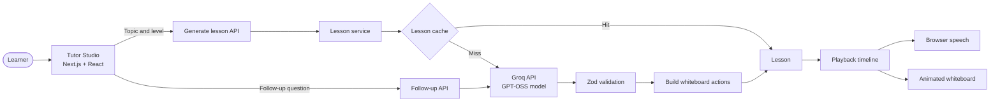
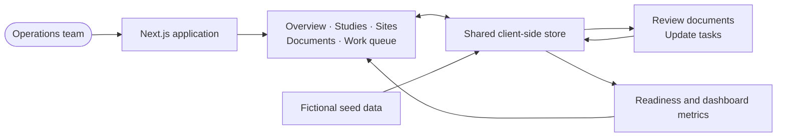

<h1 align="center">Hi 👋, I'm Varun</h1>
<h3 align="center">Frontend developer building polished web apps and AI-assisted products</h3>

  

  
  

---

### 🛠️ Tech Stack

  

### 🤖 AI in Practice

  
  
  

---

### 🚀 Featured Projects

#### [ChalkAI](https://chalk-ai-tan.vercel.app/) · [Source](https://github.com/2yb/chalk-ai)

AI-powered visual lessons with narrated playback and an interactive whiteboard.

`Next.js` `React` `TypeScript` `Groq` `Zod`

#### [TrialFlow](https://trialflow-tau.vercel.app/overview) · [Source](https://github.com/2yb/trialflow)

A clinical-trial site-readiness prototype for study monitoring, document review, and operational work queues.

`Next.js` `React` `TypeScript` `Tailwind CSS` `Vitest`

#### [Paste App](https://lobster-git-main-2ybs-projects.vercel.app/)

A fast pastebin clone with real-time UI sharing.

#### [Hi There](https://hi-there-hyjkk6uh7-2ybs-projects.vercel.app/)

A personal portfolio with smooth animations, light/dark themes, and SEO optimization.

---

### 🧭 Architecture at a Glance

#### ChalkAI · AI lesson pipeline

#### TrialFlow · shared workflow state

---

### 📊 GitHub Activity

  
  

---

### 📫 Let's Connect

  
  
  

